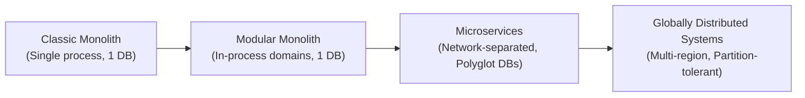
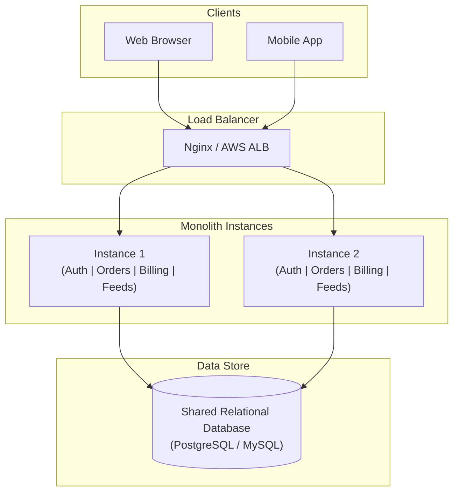
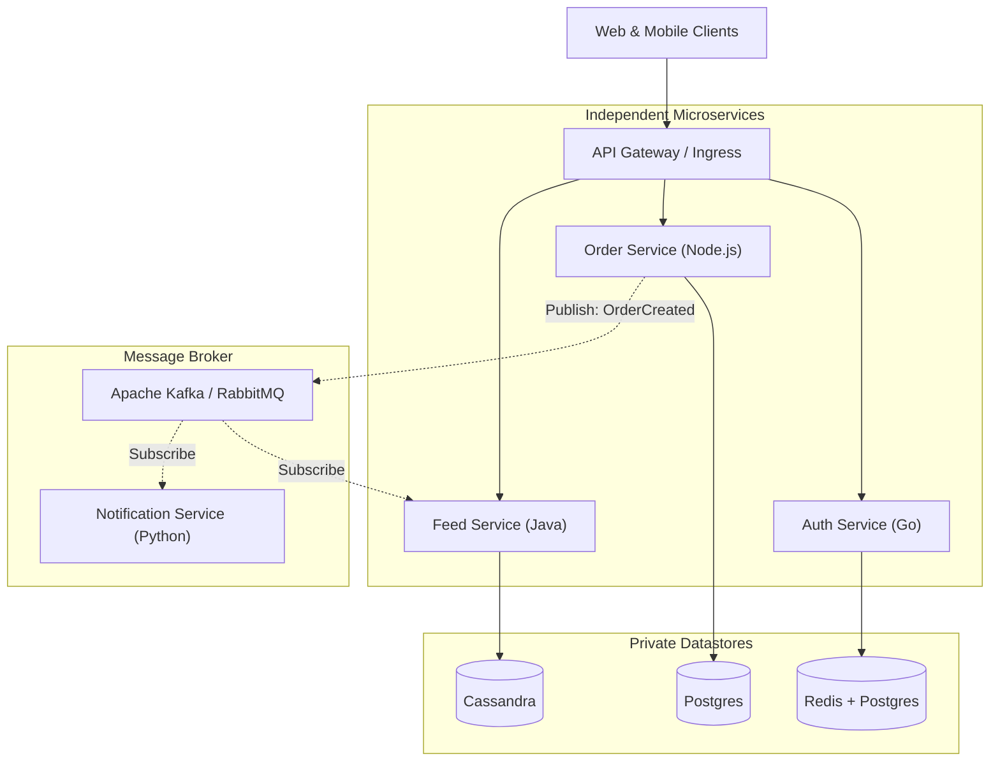
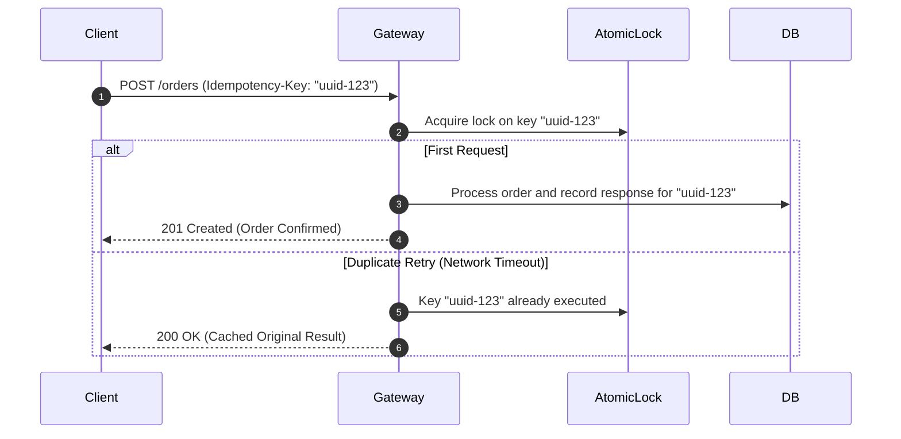
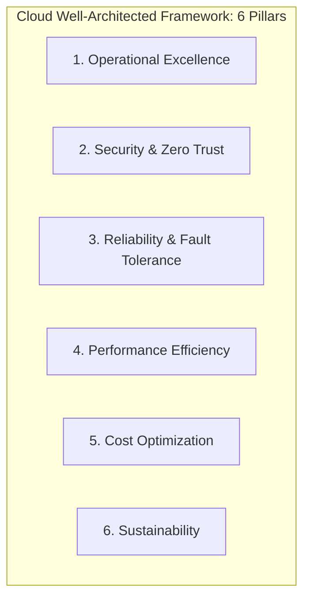
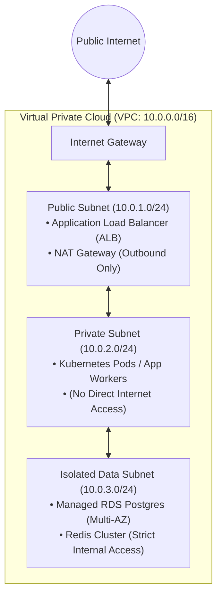
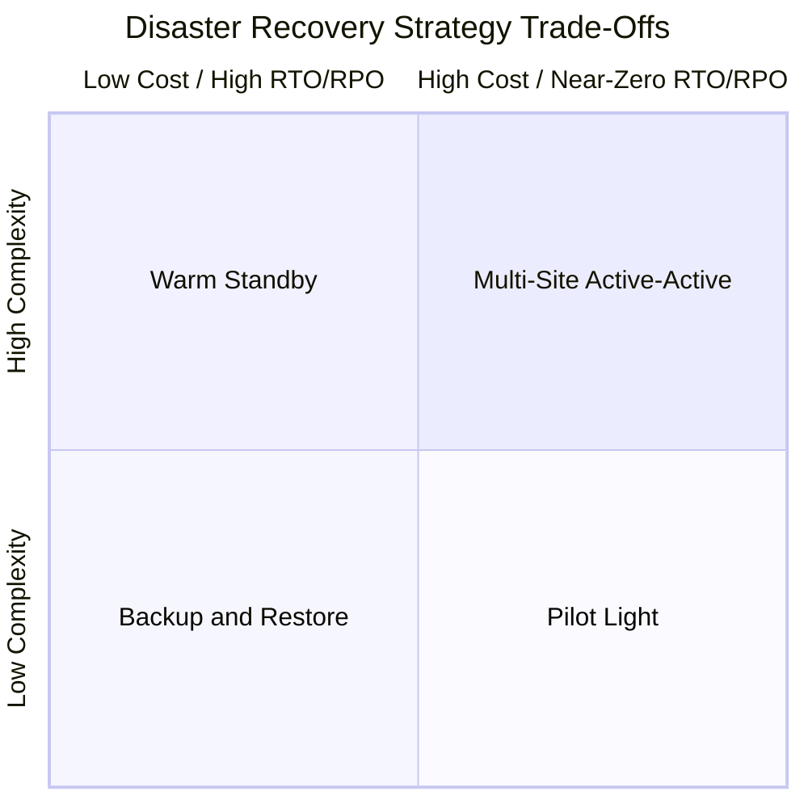
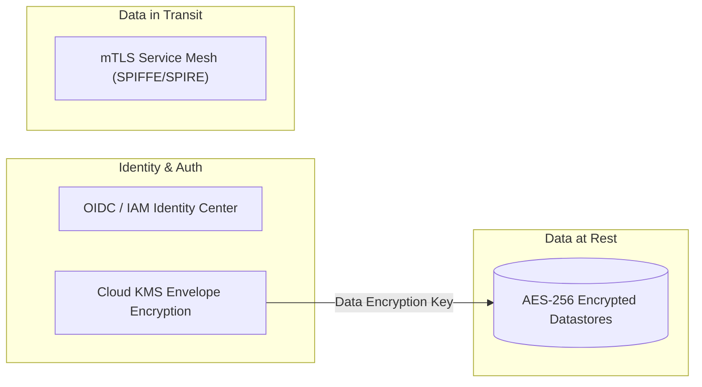
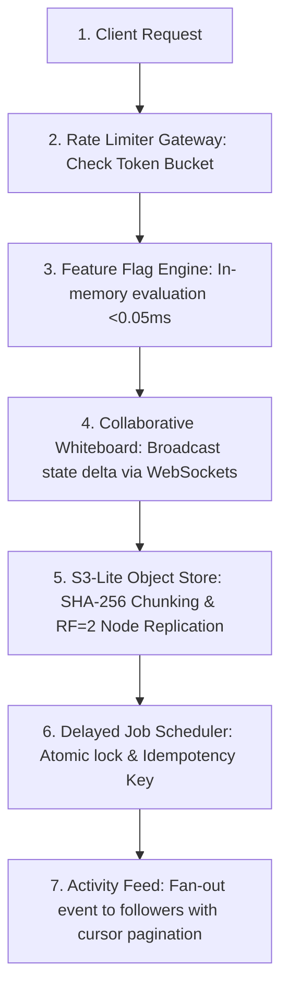

# ⚡ SysLab ArchitectOS: Interactive System Design Workbench & Architecture Master Guide

An all-in-one interactive full-stack platform combining the **6 core distributed system design archetypes** into a single cohesive project, engineered for rapid hands-on learning, system architecture mastery, and FAANG-style interview prep.

---

## 🏛️ Monorepo Architecture Overview

This unified monorepo integrates distributed systems infrastructure, financial quantitative engines, and Kubernetes container orchestration:

| Subsystem | Directory | Port | Description |
| :--- | :--- | :--- | :--- |
| **SysLab ArchitectOS** | Root (`./`) | `:3000` | Distributed systems workbench (Object Storage, Redis Backplane, Floci Cloud, SQS). |
| **AlphaForge Quant Terminal** | `quant-terminal/` | `:4000` | Institutional algorithmic trading desk (Spot Gold `XAU/USD`, Forex, Crypto, Capital.com & Binance gateways). |
| **Kubernetes Orchestration** | `k8s/` | Ingress / Cluster | Full production manifests (Deployments, Services, HPA, Ingress, Kustomize). |

---

## 🚀 Unified Quick Start

### 1. Run via Docker Compose (Both Systems Together)
```bash
docker compose up --build
# SysLab:         http://localhost:3000
# Quant Terminal: http://localhost:4000
```

### 2. Deploy to Kubernetes
```bash
kubectl apply -k k8s/
```

### 3. Run Locally via Node.js
```bash
# Terminal 1: Start SysLab Architecture Platform (Port 3000)
npm start

# Terminal 2: Start AlphaForge Quant Terminal (Port 4000)
cd quant-terminal
npm start
```

---

# 📚 TABLE OF CONTENTS

1. [Architectural Spectrum: Monolith vs Microservices](#1-the-architectural-spectrum)
2. [The Big Monolith](#2-the-big-monolith)
3. [The Modular Monolith (Pragmatic Middle Ground)](#3-the-pragmatic-middle-ground-the-modular-monolith)
4. [Microservices Architecture](#4-microservices-architecture)
5. [Architectural Comparison Matrix](#5-architectural-comparison-matrix)
6. [Distributed Systems Masterclass: Core Fundamentals](#6-distributed-systems-masterclass-core-fundamentals)
7. [Solution Architecture & Enterprise Design Patterns](#7-solution-architecture--enterprise-design-patterns)
8. [Cloud Computing Architecture & Infrastructure](#8-cloud-computing-architecture--infrastructure)
9. [Platform Engineering, Kubernetes & SRE](#9-platform-engineering-kubernetes--sre)
10. [Cloud Security & Zero Trust Architecture](#10-cloud-security--zero-trust-architecture)
11. [The 6 Interactive Hands-on Modules in this Project](#-the-6-interactive-hands-on-modules-in-this-project)
12. [Unified End-to-End System Pipeline](#-unified-end-to-end-system-pipeline)
13. [Interactive Chaos & Failure Simulations Built-in](#-interactive-chaos--failure-simulations-built-in)

---

## 1. The Architectural Spectrum

Modern backend architecture is a continuous trade-off spectrum between **operational simplicity** and **organizational/computational scale**.



---

## 2. The Big Monolith

In a **Monolith**, all business capabilities (Authentication, Catalog, Payments, Notifications, Feeds) reside inside a **single codebase, compiled or run in a single operating system process, connected to a single database schema**.



### Why Start with a Monolith?
- **Zero Network Tax**: Calls between modules are in-memory function calls executed in nanoseconds ($\sim 10\text{–}50\,\text{ns}$) rather than HTTP/gRPC network hops ($\sim 2\text{–}50\,\text{ms}$).
- **ACID Transactions**: Guarantee absolute consistency with a single database transaction:
  ```sql
  BEGIN TRANSACTION;
    UPDATE accounts SET balance = balance - 100 WHERE id = 1;
    INSERT INTO orders (user_id, amount) VALUES (1, 100);
  COMMIT;
  ```
- **Frictionless Developer Experience**: One repository, one command to boot locally (`npm start`), straightforward stack traces, and single-step CI/CD.

### The Monolith Breaking Point
1. **Deployment Bottleneck & Lockstep Releases**: 50 engineers across 5 teams push to `main`. If a bug in the notification template fails tests, checkout deployments are blocked.
2. **Blast Radius**: A single memory leak or unhandled exception in an uncritical feature (e.g. avatar resizing) crashes the entire Node.js process, taking down authentication and payments.
3. **Uneven Scaling Needs**: If video transcoding needs 32 CPU cores and 64 GB RAM, but the order service needs 2 CPU cores, you must scale the *entire* monolith instance, multiplying cloud costs.
4. **Database Connection Pool Exhaustion**: Every scaled monolith replica opens connection pools to the same central database, leading to lock contention and CPU bottlenecks.

---

## 3. The Pragmatic Middle Ground: The Modular Monolith

Before jumping to microservices, elite engineering teams (Shopify, Basecamp, Stack Overflow) adopt a **Modular Monolith**:
- **Single Process & Single Deployment Unit**, but with **strict domain boundaries**.
- Code is split into internal packages or modules (e.g. `/domains/billing`, `/domains/auth`).
- Domains communicate **only through explicit interfaces or an in-memory event bus**—never by querying another domain's database tables directly.
- Keeps 95% of microservice benefits (clean boundaries, decoupled logic) without the operational tax of distributed systems.

---

## 4. Microservices Architecture

A **Microservices Architecture** decomposes the system into small, autonomous, network-accessible services centered around business boundaries. Each service owns its **own private database** (Database-per-Service pattern).



### Key Advantages:
- **Independent Deployability**: Team Payments can deploy 20 times a day without coordinating with Team Feeds.
- **Granular Elasticity**: Scale the high-traffic Recommendation Service to 100 replicas while keeping Billing at 3 replicas.
- **Fault Isolation**: If the Feed Service experiences a cascading crash, users can still authenticate, add items to cart, and checkout.
- **Polyglot Stacks**: Use Go or Rust for high-throughput I/O, Python for ML/LLM pipelines, and Node.js/TypeScript for CRUD APIs.

### The "Microservices Tax" (The Hidden Complexities):
- **No More ACID Transactions**: You cannot execute a two-table SQL transaction across two microservices. You must use **Sagas (orchestrated or choreographed)** and embrace **Eventual Consistency**.
- **The Dual-Write Problem**: Updating your database and publishing a Kafka message is not atomic. If the DB write succeeds but Kafka fails, your system enters an inconsistent state (solved via the **Transactional Outbox Pattern**).
- **Latency Cascades**: In a deep call chain ($A \rightarrow B \rightarrow C \rightarrow D$), latency is additive, and a tail-latency spike on $D$ stalls all upstream callers.
- **Operational Overhead**: Requires Kubernetes, Service Meshes (Istio/Linkerd), Distributed Tracing (OpenTelemetry/Jaeger), central log aggregators, and dedicated DevOps platform teams.

---

## 5. Architectural Comparison Matrix

| Metric | Traditional Monolith | Modular Monolith | Microservices |
| :--- | :--- | :--- | :--- |
| **Codebase** | Single repository | Single repository | Multi-repo or Monorepo |
| **Process Model** | Single process | Single process | Dozens to hundreds of processes |
| **Inter-Service Communication** | In-memory function calls ($<0.05\,\mu\text{s}$) | In-memory interfaces / event bus | Network protocols: HTTP/REST, gRPC, Kafka ($2\text{–}50\,\text{ms}$) |
| **Database Architecture** | 1 shared database | 1 DB with strict schema ownership | Database-per-service (heterogeneous) |
| **Transaction Model** | Strict ACID | Strict ACID | BASE (Eventual Consistency, Saga) |
| **Blast Radius** | High (process crash kills all) | High (unless isolated threads/workers) | Low (isolated to individual services) |
| **Deployment Independence**| None (all-or-nothing) | None (all-or-nothing) | Complete independence |
| **Operational Complexity**| Low | Low to Moderate | High (Kubernetes, Envoy, Tracing, CI/CD) |
| **Optimal Organization**| 1–25 engineers | 10–100 engineers | 100+ engineers across multiple orgs |

---

## 6. Distributed Systems Masterclass: Core Fundamentals

Once you split software across machines over a network, you enter the domain of **Distributed Systems**.

### A. The 8 Fallacies of Distributed Computing
Never assume:
1. *The network is reliable* $\rightarrow$ Packets drop, TCP handshakes stall, routes flapping.
2. *Latency is zero* $\rightarrow$ Network serialization, routing, and switching take real time.
3. *Bandwidth is infinite* $\rightarrow$ Overloading networks creates queueing delay and packet loss.
4. *The network is secure* $\rightarrow$ All inter-service traffic must be encrypted (mTLS).
5. *Topology doesn't change* $\rightarrow$ Cloud VMs terminate, IP addresses change, containers rebalance.
6. *There is one administrator* $\rightarrow$ Different teams manage different subnets, proxies, and firewalls.
7. *Transport cost is zero* $\rightarrow$ JSON serialization/deserialization consumes significant CPU.
8. *The network is homogeneous* $\rightarrow$ Devices vary in OS, network interfaces, and socket limits.

---

### B. The CAP Theorem & PACELC

The **CAP Theorem** states that in any distributed data store, you can only pick **two of three**:
- **C (Consistency)**: Every read receives the most recent write or an error.
- **A (Availability)**: Every non-failing node returns a non-error response (without guarantee of latest write).
- **P (Partition Tolerance)**: The system continues to operate despite arbitrary packet drops or network partitions.

> ⚠️ **Reality Check**: On physical networks, network partitions are inevitable ($P$ is non-negotiable). Therefore, the real architectural choice during a partition is **CP vs AP**:
> - **CP (Choose Consistency)**: Reject writes or delay reads until network splits heal (e.g. Banking ledgers, Etcd, ZooKeeper).
> - **AP (Choose Availability)**: Allow writes and reads on both sides of the partition; reconcile divergence later (e.g. DNS, Amazon Shopping Cart, Social Feeds).

**PACELC Extension**:
> If there is a **P**artition, how do you trade off **A**vailability vs **C**onsistency?
> **E**lse (under normal conditions), how do you trade off **L**atency vs **C**onsistency?

---

### C. Idempotency & Retries

In a distributed system, network timeouts are ambiguous:
> *Did the request fail to reach the server? Or did the server process it and fail to send the response?*

If a client retries blindly, it risks **double-charging a credit card** or **double-publishing a post**.

**Solution**: The **Idempotency Key Pattern**:


---

### D. Data Replication & Quorums

To survive node failures, distributed systems replicate data across multiple physical machines:
- **Replication Factor (RF)**: Number of nodes storing each piece of data ($RF = 2$ or $RF = 3$).
- **Strict Quorum Formula**:
  $$R + W > N$$
  Where $N$ = Replication factor, $W$ = Number of nodes that must acknowledge a write, $R$ = Number of nodes that must respond to a read.
  - If $N=3, W=2, R=2$: $2 + 2 > 3$ (Guaranteed strong consistency; the read quorum will always overlap with at least one node containing the latest write).

---

### E. Resiliency Patterns: Protecting Against Cascading Failure

1. **Token Bucket Rate Limiting**: Buffers burst traffic while enforcing an average rate limit.
2. **Circuit Breakers**: Tracks error rates. If downstream calls fail $>50\%$ of the time, the circuit "trips open", instantly failing fast with a fallback and preventing thread exhaustion.
3. **Exponential Backoff with Jitter**:
   $$\text{WaitTime} = \min(\text{MaxWait}, \text{Base} \times 2^{\text{attempt}}) + \text{random\_jitter}$$
   Prevents the **Thundering Herd** problem where thousands of retrying clients hit a recovering server at the exact same millisecond.

---

## 7. Solution Architecture & Enterprise Design Patterns

Solution architecture focuses on structuring software systems to satisfy business and non-functional requirements (scalability, security, maintainability).



### Essential Enterprise Architectural Patterns

#### 1. Backend-for-Frontend (BFF) Pattern
Rather than one monolithic API serving iOS, Android, and Web, deploy dedicated lightweight gateways for each frontend client:
- Tailors response payloads (e.g. mobile gets stripped-down JSON to conserve cellular data).
- Eliminates client-side over-fetching and orchestrates downstream service calls in the cloud network.

#### 2. CQRS (Command Query Responsibility Segregation)
Separates the **write model (Commands)** from the **read model (Queries)**:
- **Commands**: High-integrity, write-optimized data stores (PostgreSQL) enforcing business invariants.
- **Queries**: Denormalized, read-optimized data stores (Elasticsearch, Redis) updated asynchronously via events.

#### 3. Event Sourcing
Instead of storing only the *current state* of an entity, store an **immutable sequence of state-changing events**:
- Example: Instead of storing `balance: $400`, store:
  1. `AccountCreated`
  2. `MoneyDeposited: +$500`
  3. `MoneyWithdrawn: -$100`
- Provides an immutable audit log, time-travel debugging, and the ability to rebuild new read-views from scratch.

#### 4. The Saga Pattern (Distributed Transactions)
How to coordinate transactions across multiple microservices without distributed two-phase locking ($2\text{PC}$):
- **Choreography**: Each service produces and listens to domain events (e.g. `OrderCreated` $\rightarrow$ `PaymentCharged` $\rightarrow$ `InventoryReserved`). If inventory reservation fails, an `InventoryFailed` event triggers compensating transactions (`RefundPayment`, `CancelOrder`).
- **Orchestration**: A centralized orchestrator (e.g. AWS Step Functions or Temporal) explicitly commands each service what to do and handles failure rollbacks.

#### 5. Transactional Outbox Pattern
Solves the **Dual-Write Problem**:
- When updating a database and publishing to Kafka, write the event into an `outbox` table in the *same* database transaction as your business entity.
- A background process (or Debezium via Change Data Capture / CDC) reads the outbox table and reliably publishes to Kafka with at-least-once delivery guarantees.

#### 6. Strangler Fig Pattern (Monolith Migration)
Safely migrating from a Big Monolith to Microservices:
- Place an API Gateway in front of the monolith.
- Implement new features or extract existing domains one by one into independent microservices.
- Gradually route traffic away from the monolith until the legacy application is completely "strangled" and decommissioned.

---

## 8. Cloud Computing Architecture & Infrastructure

Cloud computing replaces physical data centers with programmable, on-demand infrastructure.

### A. The Cloud Service Pyramid

| Model | What the Cloud Provider Manages | What You Manage | Examples |
| :--- | :--- | :--- | :--- |
| **IaaS** (Infrastructure as a Service) | Data center, Physical Servers, Hypervisor | OS, Runtime, Middleware, App, Data | AWS EC2, GCP Compute Engine, Azure VMs |
| **PaaS** (Platform as a Service) | Physical hardware, OS, Runtime, Patching | Application Code, Configurations, Data | Render, Fly.io, Heroku, AWS Elastic Beanstalk |
| **Serverless (FaaS)** | Everything, including scaling to zero | Stateless function code, Event triggers | AWS Lambda, Cloudflare Workers, Google Cloud Functions |
| **SaaS** (Software as a Service) | Entire Application Stack | End-user data, User permissions | GitHub, Stripe, Datadog, Slack |

---

### B. Cloud Networking Deep Dive

A robust cloud infrastructure isolates traffic through a **Virtual Private Cloud (VPC)**:



- **CIDR Blocks**: Defines private IP ranges (e.g. `/16` gives 65,536 IPs; `/24` gives 256 IPs).
- **Public Subnets**: Route table directs `0.0.0.0/0` to an **Internet Gateway (IGW)**. Holds Load Balancers and Bastion Hosts.
- **Private Subnets**: Route outbound internet traffic through a **NAT Gateway** (allowing app servers to download security patches or query 3rd-party APIs without accepting incoming connections).
- **Security Groups vs. Network ACLs (NACLs)**:
  - **Security Groups**: Stateful firewall applied at the instance/ENI level (allowing port 443 inbound automatically allows return outbound traffic).
  - **NACLs**: Stateless firewall applied at the subnet boundary (requires explicit inbound and outbound rules).
- **VPC Endpoints & AWS PrivateLink**: Connects private workloads directly to managed cloud services (S3, DynamoDB) via private AWS backbone networks without routing over the public internet.

---

### C. Cloud Storage Tiers

1. **Block Storage** (AWS EBS / Persistent Disks): Virtual hard drives mounted directly to a single compute node. High IOPS, ultra-low latency, formatted with file systems (ext4/XFS).
2. **Object Storage** (AWS S3 / Google Cloud Storage): Flat namespace, HTTP REST API (`GET`, `PUT`), infinite horizontal scalability, content-addressable storage, metadata tagging.
   - *Tiers*: S3 Standard $\rightarrow$ S3 Infrequent Access (cheaper storage, retrieval fee) $\rightarrow$ S3 Glacier Flexible $\rightarrow$ Glacier Deep Archive (pennies/GB, hours retrieval time).
3. **File Storage** (AWS EFS / NFS): Shared file systems that can be concurrently mounted across hundreds of compute instances.

---

### D. Disaster Recovery (DR) Strategies: RTO vs RPO

- **RPO (Recovery Point Objective)**: How much data loss can your business tolerate? (Measured in time: e.g. 1 hour of lost writes).
- **RTO (Recovery Time Objective)**: How much downtime can your business tolerate? (Measured in time: e.g. 15 minutes to recover service).



1. **Backup & Restore**: Periodic database snapshots backed up to secondary region. In a disaster, provision infrastructure via Terraform and restore backups. (RPO: hours, RTO: 4–24 hours, Lowest Cost).
2. **Pilot Light**: Databases continuously replicate to secondary region. Compute nodes are kept off or at size 0 until failover. (RPO: seconds, RTO: 30–60 mins, Low-Moderate Cost).
3. **Warm Standby**: Scaled-down, fully functional mirror running in secondary region. In a disaster, auto-scaling groups expand instances to 100% capacity. (RPO: seconds, RTO: minutes, Moderate-High Cost).
4. **Multi-Site Active-Active**: Workload runs at full scale in 2+ regions simultaneously. Anycast DNS or CloudFront splits traffic across both sites. Immediate zero-downtime failover. (RPO: $\sim 0$, RTO: $\sim 0$, Highest Cost).

---

## 9. Platform Engineering, Kubernetes & SRE

Platform Engineering builds the internal developer platforms (IDP) enabling product teams to deploy, observe, and maintain microservices reliably.

### A. Infrastructure as Code (IaC) & GitOps
- **Declarative IaC (Terraform, OpenTofu, Pulumi)**: You define *desired state* in code files (`.tf`). The engine computes execution plans and converges physical cloud resources to match the code.
- **GitOps (ArgoCD, Flux)**: Git is the single source of truth for both infrastructure and Kubernetes manifests. An in-cluster operator continuously compares the running cluster state against Git and auto-heals any configuration drift.

---

### B. Kubernetes Architecture & Core Primitives

Kubernetes (K8s) is the industry standard container orchestrator.

```mermaid
graph TD
    subgraph ControlPlane [Control Plane Master Nodes]
        API[API Server (kube-apiserver)]
        Etcd[(etcd: Distributed Raft KV Store)]
        Sched[Kube Scheduler]
        CM[Kube Controller Manager]
        API <--> Etcd
        API <--> Sched
        API <--> CM
    end

    subgraph WorkerNodes [Worker Node Fleet]
        API <--> Kubelet1[Kubelet]
        API <--> Kubelet2[Kubelet]
        Kubelet1 --> Pod1[Pod: Order Svc]
        Kubelet1 --> Pod2[Pod: Auth Svc]
        Kubelet2 --> Pod3[Pod: Feed Svc]
    end
```

- **Pod**: The smallest deployable unit; one or more containers sharing network namespace (localhost) and storage volumes.
- **Deployment**: Declarative controller managing rolling updates, rollbacks, and replica counts.
- **Service**: Stable virtual IP and DNS name abstracting an ephemeral group of Pods:
  - `ClusterIP`: Internal-only pod-to-pod routing.
  - `NodePort`: Exposes the service on a static port on each worker node IP.
  - `LoadBalancer`: Provisions a cloud provider load balancer (e.g. AWS NLB/ALB).
- **Ingress Controller (Envoy / Nginx)**: Manages external HTTP/HTTPS routing, SSL termination, and host/path-based routing.
- **HPA (Horizontal Pod Autoscaler)**: Automatically scales the number of Pod replicas based on observed CPU utilization, memory, or custom Prometheus metrics.

---

### C. Observability & SRE (Site Reliability Engineering)

Observability is the ability to infer the internal state of a system based on its external telemetry.

#### The Three Pillars of Observability:
1. **Metrics**: Numerical time-series data aggregated over intervals (Counter, Gauge, Histogram). Ex: Request rate, CPU load, memory usage (Prometheus + Grafana).
2. **Logs**: Structured, timestamped event records (JSON format) containing contextual fields (userId, traceId, errorCode) aggregated centrally (ELK Stack, Loki, Datadog).
3. **Distributed Tracing**: Records the full lifecycle of a request as it traverses microservices via a unique `trace_id` and nested `span_id`s (OpenTelemetry + Jaeger).

#### The 4 Golden Signals (Google SRE):
1. **Latency**: The time it takes to service a request (measured in p50, p95, p99 percentiles, not averages).
2. **Traffic**: Demand placed on your system (e.g. HTTP requests per second, I/O bandwidth).
3. **Errors**: The rate of requests that fail (e.g. HTTP 500s or unhandled exceptions).
4. **Saturation**: How full your service is (e.g. memory usage, database connection pool saturation, disk I/O limits).

#### SLI vs SLO vs SLA:
- **SLI (Service Level Indicator)**: The actual metric measured (e.g. *99.8% of GET /orders responses return in $< 200\text{ms}$*).
- **SLO (Service Level Objective)**: The internal target the engineering team strives to hit (e.g. *99.9% uptime over a 30-day rolling window*).
- **SLA (Service Level Agreement)**: The contractual promise to paying customers with financial penalties for breach (e.g. *99.5% uptime or 20% billing credit*).
- **Error Budget**: The acceptable margin of failure ($1 - \text{SLO}$). If your SLO is 99.9%, you have an error budget of 0.1% (43 minutes of downtime per month) to spend on shipping new features and making risky deployments.

---

## 10. Cloud Security & Zero Trust Architecture

In cloud engineering, perimeter-based security ("firewall on the outside, trusted on the inside") is dead. Modern architectures follow **Zero Trust**: *Never trust, always verify*.



### Core Security Tenets:
1. **Least Privilege IAM**: Every microservice and developer has permissions strictly limited to what is required. Services use temporary credentials via **STS / AssumeRole** or Kubernetes Service Account tokens (IRSA)—never hardcoded API keys.
2. **Envelope Encryption**: Data is encrypted using a unique local Data Encryption Key (DEK). The DEK is then encrypted under a Master Key stored in a hardware security module (AWS KMS / Cloud HSM) and stored alongside the ciphertext.
3. **mTLS (Mutual TLS)**: Every microservice verifies both the server and client certificate, ensuring all internal cluster traffic is authenticated and encrypted in transit.
4. **Secrets Management**: Secrets (database passwords, API tokens) are rotated automatically and injected into container memory at runtime via HashiCorp Vault, AWS Secrets Manager, or Doppler.
5. **WAF & DDoS Protection**: Cloudflare, AWS WAF, and AWS Shield mitigate Layer 7 (SQL injection, XSS, bots) and Layer 3/4 SYN floods and UDP amplification attacks before requests reach your origin servers.

---

## 🏛️ The 6 Interactive Hands-on Modules in this Project

This repository implements the 6 core archetypes under 300 lines of clean JavaScript each so you can inspect, test, and break them:

| # | System Design Module | Core Architecture Principles | Key Tradeoffs & Gotchas | File Location |
|---|----------------------|------------------------------|-------------------------|---------------|
| **1** | **Collaborative Whiteboard** | **WebSockets delta-sync**, monotonic sequence numbering (`seq`), log compaction & snapshots, ephemeral cursor presence | Sending 80-byte mutation deltas saves **>98% bandwidth** vs full canvas snapshots; sequence counters detect packet drops. | [`server/services/whiteboardService.js`](server/services/whiteboardService.js) |
| **2** | **Feature Flag Service** | **Low-latency in-memory reads (<0.1ms)**, **Server-Sent Events (SSE)** streaming cache invalidation, deterministic hash rollouts | Never make an HTTP round-trip on `isEnabled()`. Hash `(userId + key) % 100` for deterministic sticky rollouts without database lookups. | [`server/services/featureFlagService.js`](server/services/featureFlagService.js) |
| **3** | **Social Post Scheduler** | **Delayed priority queue**, worker tick & atomic locking, **Idempotency Keys**, exponential backoff, Dead-Letter Queue (DLQ) | Storing an idempotency key guarantees that client network timeouts & retries never publish duplicate posts; DLQ isolates poison pills. | [`server/services/postSchedulerService.js`](server/services/postSchedulerService.js) |
| **4** | **API Rate Limiter Gateway** | **Token Bucket** (bursts) & **Sliding Window Counter**, RFC headers (`X-RateLimit-*`, `Retry-After: 429`), OpenAI proxy | Token bucket handles burst traffic gracefully; sliding window eliminates edge-boundary 2x spikes. | [`server/services/rateLimiterService.js`](server/services/rateLimiterService.js) |
| **5** | **Activity Feed & Fan-Out** | **Fan-Out on Write (Push)** vs **Fan-Out on Read (Pull)**, Hybrid celebrity routing, **Cursor-based pagination** | Push delivers $O(1)$ reads but suffers write amplification on celebrities. Hybrid uses push for standard users and pull for celebrities. | [`server/services/activityFeedService.js`](server/services/activityFeedService.js) |
| **6** | **Distributed Object Storage (S3-Lite)** | **Metadata vs Chunk separation**, SHA-256 Content-Addressable Storage (CAS), **Replication Factor 2**, node failover | Chunks are distributed across Node A, B, and C. Taking Node A offline triggers transparent failover reads from replica nodes. | [`server/services/objectStorageService.js`](server/services/objectStorageService.js) |

---

## ⚡ Unified End-to-End System Pipeline

SysLab provides a **1-click end-to-end orchestration pipeline** that chains all 6 distributed systems together into a production workflow:



---

## 🧪 Interactive Chaos & Failure Simulations Built-in

Open `http://localhost:3000` to interact with the chaos controls:
1. **Whiteboard**: Real-time multi-client canvas drawing with live delta byte counters.
2. **Feature Flags**: Live SSE stream log; in-memory evaluation benchmark tool (<0.05ms); instant toggle switches.
3. **Post Scheduler**: **"Simulate Duplicate Retries"** button (fires concurrent requests with the same idempotency key to test deduplication); chaos downstream failure rate slider.
4. **API Rate Limiter**: Animated Token Bucket water container; **"Fire Burst of 8 Requests"** button triggering HTTP 429 Too Many Requests; Free vs Pro tiers.
5. **Activity Feed**: Live timeline; **"Run 100x50 Benchmark"** comparing computational costs of Fan-out on write vs read; cursor pagination.
6. **Object Storage**: **"Simulate Crash"** toggle for Node A, Node B, and Node C; **"Read & Verify Failover"** inspector demonstrating automatic replica failover.

---

## 🎓 Day-by-Day Study Plan

For a structured multi-day curriculum and FAANG interview answer templates, refer to:
👉 [`LEARNING_ACCELERATOR.md`](LEARNING_ACCELERATOR.md)
