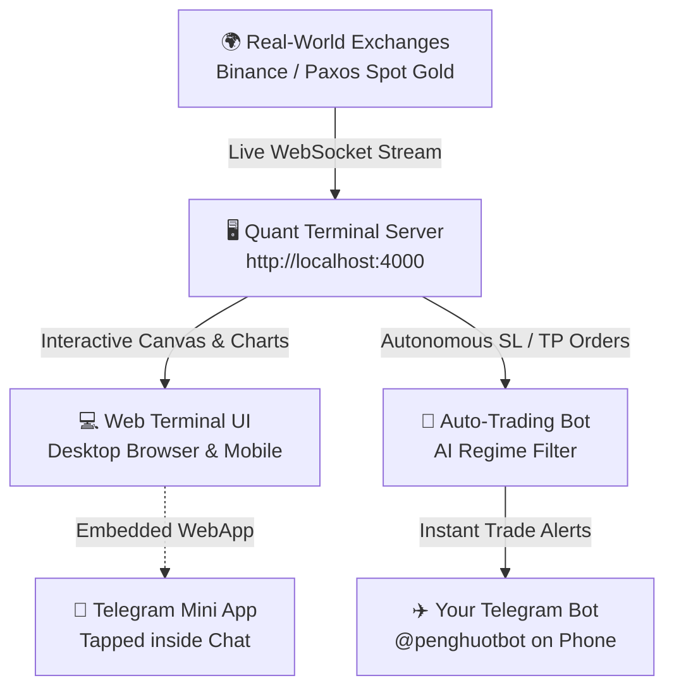

# 📘 Beginner's Zero-Knowledge Guide to AlphaForge Quant

> **Welcome!** If you have zero prior experience with quantitative finance, trading bots, code, or Telegram Mini Apps, **this guide is written specifically for you**. Everything is explained in plain, simple English with step-by-step instructions.

---

## 🧭 1. What Is This System? (The Big Picture)

Think of **AlphaForge Quant** as your own private financial command center made of 4 connected parts:



1. **The Live Market Feed**: Streams real-world asset prices every single second without needing any paid accounts or private API keys (Spot Gold `XAU-USD`, Bitcoin `BTC-USD`, Ethereum `ETH-USD`, and Solana `SOL-USD`).
2. **The Terminal UI (Frontend)**: A TradingView-style dark-mode cyber interface with technical indicators (EMA, SMA, Bollinger Bands, VWAP), Order Book depth (Bid/Ask queues), and backtesting engines.
3. **The Auto-Trading Bot**: An algorithmic robot that buys or sells based on mathematical rules (RSI, Moving Average Crossover) and protects your capital using **Hard Stop-Loss (-2%)** and **Take-Profit (+5%)**. It also uses an **AI Regime Filter** to pause trading when the market is crashing or behaving erratically.
4. **The Telegram Integration**: Sends instant push notifications to your phone whenever an order executes, and lets you query live prices by typing `/price btc` or `/status` inside your Telegram chat.

---

## ⚡ 2. How to Start the Terminal Anytime (In 10 Seconds)

Whenever you restart your computer or want to use the terminal later:

1. Open **PowerShell** or **Command Prompt** on Windows.
2. Navigate to your project folder:
   ```powershell
   cd "d:\testing the project\quant-terminal"
   ```
3. Start the server:
   ```powershell
   npm start
   ```
4. Open your browser and go to:
   ```text
   http://localhost:4000
   ```
That's it! Your charts, real-time gold feeds, and bot are immediately active.

---

## 📱 3. How to Open It on Your Phone as a Telegram Mini App (TMA)

A **Telegram Mini App** is a full web application that opens directly inside Telegram when you tap a button (just like popular Web3 apps like Notcoin, Hamster Kombat, or Blum).

Telegram requires a secure `https://` link to display a Mini App inside its mobile app. Here is how to get one in 1 minute completely free:

### Step 3.1: Expose Your Local Terminal via Free Cloudflare Tunnel
Keep your terminal running (`npm start`), then open a second PowerShell window and run:
```powershell
npx -y cloudflared tunnel --url http://localhost:4000
```
*Note: This is an official, 100% free tool provided by Cloudflare. You do not need to register an account or pay anything.*

In the output, look for a line like:
```text
https://random-words-123.trycloudflare.com
```
👉 Copy that **`https://...`** URL.

---

### Step 3.2: Set Up the Mini App Button in Telegram
1. Open Telegram on your phone or PC and message **`@BotFather`**.
2. Send the command:
   ```text
   /setmenubutton
   ```
3. Select your bot: **`@penghuotbot`** (or your bot's username).
4. BotFather will ask for the URL:
   👉 **Paste the `https://...` link** you copied in Step 3.1.
5. BotFather will ask for the button title:
   👉 Type: **`AlphaForge Terminal`** (or anything you like).

---

### Step 3.3: Try It on Your Phone!
1. Open your chat with **`@penghuotbot`** in Telegram on your phone.
2. Look at the bottom-left corner next to where you type messages.
3. You will see a button labeled **`AlphaForge Terminal`** (or a small grid/app icon).
4. **Tap it!** The full trading terminal will slide up inside Telegram with live charts, order books, and bot controls!

---

## ✈️ 4. Telegram Bot Commands You Can Use Right Now

You can chat with your bot directly inside Telegram from anywhere in the world:

| Command | What It Does | Example Response |
| :--- | :--- | :--- |
| **`/start`** or **`/help`** | Shows the main bot menu and available commands | Menu with quick action buttons |
| **`/price btc`** | Checks live Bitcoin price from the engine | `📈 BTC-USD Live Price: $81,338.00` |
| **`/price gold`** | Checks Spot Gold quote | `🥇 Spot Gold: $2,685.00 / oz` |
| **`/status`** | Checks whether the bot is running and alerts are on | `🤖 Bot: ONLINE \| SL: -2% \| TP: +5%` |
| **`/ping`** | Tests connection latency | `🏓 Pong! Latency: <50ms` |

---

## 🛡️ 5. Crucial Safety & Security Rules for Beginners

Since you are learning algorithmic trading, keep these fundamental security principles in mind:

1. **Paper Trading vs. Real Money**:
   - Everything in this terminal currently runs in **Paper Trading Mode** (simulation). You get real prices from real exchanges, but zero real money is at risk. Always practice here first!
2. **Never Paste Private Keys**:
   - A legitimate trading bot or terminal **never** asks for your 12/24-word seed phrase or wallet private key.
3. **Beware of Malicious "Bookmarklets"**:
   - Remember the `zoratracker.com` site we analyzed earlier? Scammers often disguise wallet-draining scripts as "free bots" or "bookmark scripts". Never drag unknown links to your bookmark bar.
4. **Official Exchange APIs**:
   - If you ever decide to connect a real exchange account (like Binance, Bybit, or OKX) in the future, always create an API key with **`Withdrawals DISABLED`**. That guarantees that even if someone gained access to the key, they could never withdraw your funds.

---

## ❓ 6. Common Questions & Troubleshooting

### Q: Why does the Telegram alert say "Chat not found"?
Telegram protects users from spam by forbidding bots from messaging you first. Always open your bot (**`@penghuotbot`**) and tap **`/start`** once before testing.

### Q: Can I run this server 24/7 in the cloud for free?
Yes! In the `serverless-telegram/` folder of this project, you will find `worker.js` and `wrangler.toml`. This is a ready-to-deploy **Cloudflare Worker** that runs globally on Cloudflare's edge network for $0.00/month with zero server maintenance.

### Q: How do I change the assets or strategies?
- In the web terminal, use the dropdown in the top-left navigation bar to switch between **Spot Gold (XAU-USD)**, **Bitcoin (BTC-USD)**, **Ethereum**, **Solana**, **NVDA**, or **SPY**.
- In the right-hand panel, switch between **Strategy Lab** (to test historical scenarios) and **Live Bot** (to run the real-time bot).
