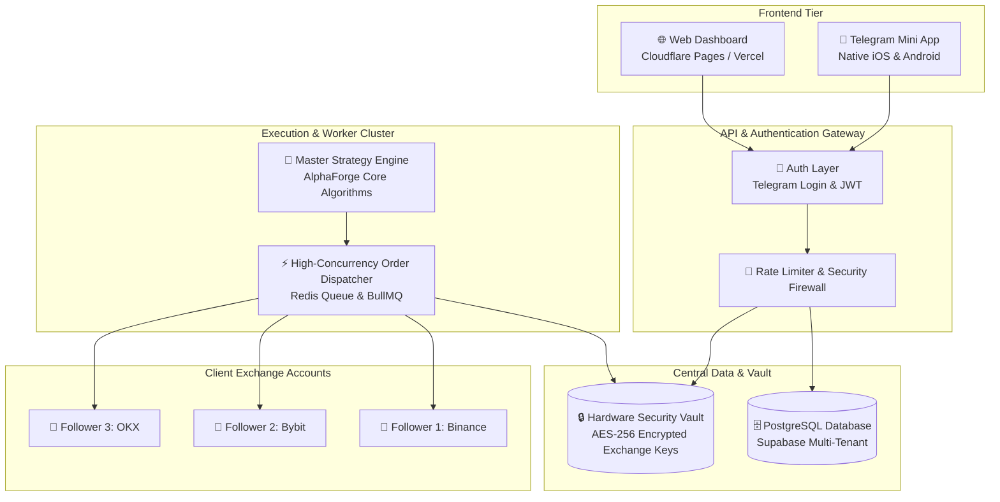

# 🚀 AlphaForge Multi-User SaaS & Copy-Trading Architecture Roadmap

> **Target**: Scale AlphaForge Quant from a single-operator terminal into a commercial, multi-tenant algorithmic trading platform supporting thousands of active users and copy-trading followers.

---

## 🏛️ 1. Multi-Tenant Architecture Overview

---

## 🔑 2. Non-Custodial Security & Key Management

1. **Exchange API Permissions**:
   - Users create API keys on Binance, Bybit, OKX, or Coinbase.
   - **`Enable Spot / Futures Trading`**: **ALLOWED** ✅
   - **`Enable Withdrawals`**: **STRICTLY BLOCKED / FORBIDDEN** ❌
2. **Envelope Encryption (AES-GCM-256)**:
   - User API secrets are encrypted using a master key derived from cloud Hardware Security Modules (AWS KMS or HashiCorp Vault).
   - In the database, the keys exist only as ciphertext: `iv:ciphertext:tag`.
3. **Dedicated Static Egress IPs**:
   - The order dispatcher routes outbound exchange traffic through static cloud IP addresses. Users whitelist these specific IPs on their exchange accounts, eliminating unauthorized access.

---

## ⚡ 3. Master-Follower Copy-Trading Engine

Rather than requiring everyday users to write complex algorithms, AlphaForge operates on a **High-Performance Signal Mirroring Model**:

1. **Master Signal Generation**:
   - The AlphaForge master quant engine monitors real-time market feeds.
   - When entry conditions are met (e.g. RSI Mean Reversion + AI Regime Filter confirmation), the master engine generates a single canonical signal:
     `{ action: 'BUY', symbol: 'BTC-USD', price: 81350.00, stopLossPct: 2.0, takeProfitPct: 5.0 }`
2. **Proportional Position Allocation**:
   - The worker queue loads all active subscribers following that strategy.
   - Allocation formula for each follower $i$:
     $$\text{Position Size}_i = \frac{\text{Follower Balance}_i \times \text{Risk Allocation Pct}}{\text{Current Market Price}}$$
3. **Concurrent Order Dispatch**:
   - Orders are dispatched asynchronously via persistent HTTP/2 connection pools directly to the respective exchange APIs in **<50 milliseconds**.
4. **Automated Telegram Delivery**:
   - Every follower receives an instant notification via the Telegram bot:
     `🚀 Order Executed: BUY 0.05 BTC @ $81,350 (Mirrored from Master)`

---

## 💳 4. Monetization & Subscription Tiers

| Tier | Price | Features |
| :--- | :--- | :--- |
| **Explorer** | Free | Real-time market streaming, backtesting simulation, Quant 101 theory |
| **Pro Trader** | $29 / month | 2 automated live bots, real-time Telegram alerts, Stop-Loss guards |
| **Alpha Copy-Trader** | $79 / month | Full master copy-trading mirroring, unlimited assets, VIP priority queue |
| **Performance Share** | 15% of Net Profit | $0 monthly fee; automated profit-sharing rebate based on net monthly gains |

---

## 📋 5. Implementation Milestones

- [x] **Milestone 1**: Core Terminal Engine, Real-Time WebSockets, Strategy Backtester, AI Regime Filter, and Telegram Bot Integration.
- [x] **Milestone 2**: Automated Unit Test Suite (`npm test`) with 100% pass rate across indicators, backtester, and risk guards.
- [ ] **Milestone 3**: User authentication (Telegram Native Login + JWT) and encrypted PostgreSQL schema.
- [ ] **Milestone 4**: Dockerize backend server and deploy to production cloud VPS (DigitalOcean / Railway) with custom domain and SSL.
- [ ] **Milestone 5**: Launch public beta for copy-trading followers with automated Stripe and USDT crypto subscription billing.
